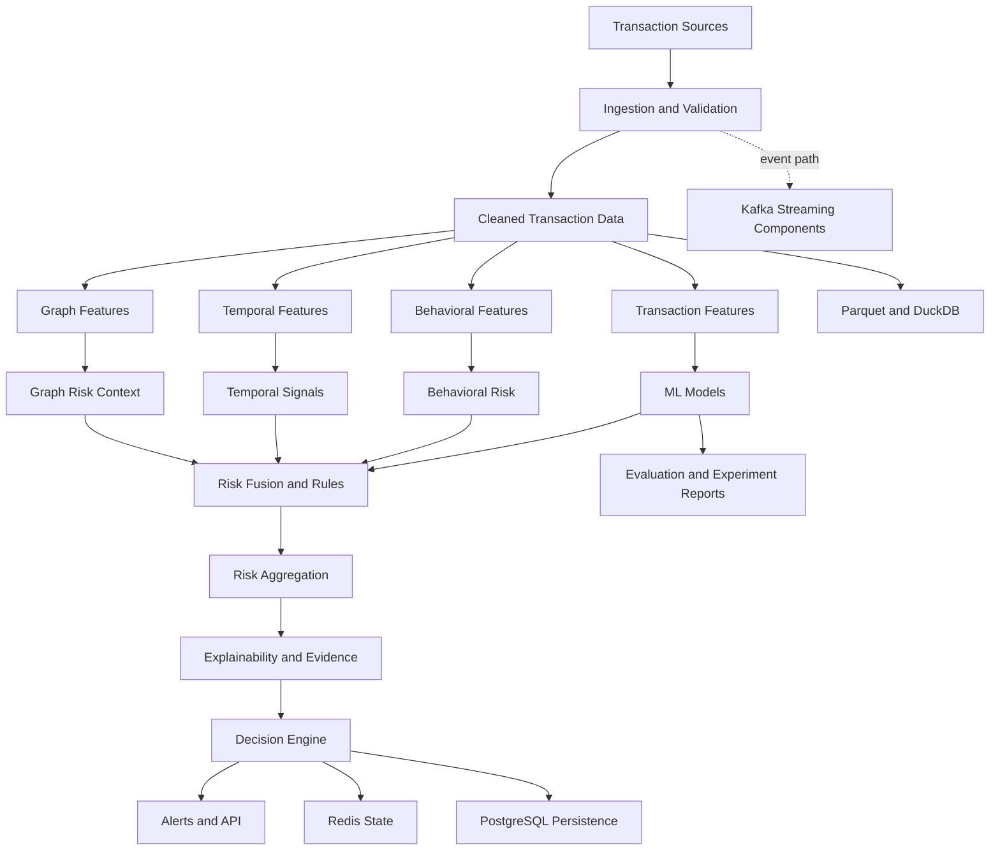

# SentinelX

### Explainable Financial Crime, Fraud & Transaction Risk Intelligence

SentinelX is a research-oriented, production-minded platform for analyzing
financial transactions, identifying suspicious behavioral and graph patterns,
combining risk signals, and producing explainable risk decisions.

The objective is not simply to train a fraud classifier. SentinelX explores
the engineering required to connect transaction data, machine learning,
behavioral intelligence, anomaly detection, risk policies, persistence, and
event processing in a reproducible system.

> **Project status:** Active development. Some modules and artifacts exist,
> but complete production readiness, end-to-end reliability, and performance
> have not yet been established. See the roadmap and testing strategy.

## Capabilities

The repository currently contains implementations or foundations for:

- Transaction schemas, ingestion, validation, cleaning, and synthetic data.
- Parquet-based data artifacts and DuckDB analytical access.
- Baseline fraud models, including Logistic Regression and XGBoost.
- Behavioral features for customers, devices, merchants, and transaction velocity.
- Temporal and graph feature engineering.
- Anomaly detection using Isolation Forest and anomaly-scoring components.
- Risk rules, signal fusion, risk aggregation, and decision-engine components.
- Evidence-based explanations and SHAP-related explainability components.
- Alert handling and risk-decision persistence.
- Redis state storage and PostgreSQL persistence components.
- Kafka producer/consumer components and streaming-related infrastructure.
- API foundations, automated tests, Docker configuration, and experiment reports.

The presence of a module does not imply that every deployment configuration,
external-service integration, or end-to-end production scenario is complete.
Consult the source code, tests, and current CI results for verification.

## Architecture



This is a conceptual architecture. The exact runtime path depends on configuration;
the diagram does not assert that every component is connected in every deployment.

## Repository Layout

```text
src/sentinelx/
  data/           Data ingestion, validation, processing, and DuckDB access
  behavior/       Behavioral intelligence and risk features
  features/       Transaction, behavioral, and temporal feature modules
  graph/          Graph construction and feature engineering
  anomaly/        Anomaly feature and scoring components
  ml/             Model features, training, evaluation, and experiments
  risk/           Risk fusion, aggregation, rules, and persistence adapters
  explainability/ Explanation and evidence components
  decision/       Decision-engine components
  state/          Redis configuration and state storage
  streaming/      Kafka components and dead-letter queue foundations
  database/       Persistence and transaction repositories

tests/            Unit, API, data, integration, and regression tests
docs/             Architecture, design, testing, security, and roadmap
reports/          Model metrics, predictions, features, and experiment artifacts
```

## Development Setup

Use Python 3.12 to match the current GitHub Actions workflow.

### 1. Create and activate a virtual environment

```powershell
py -3.12 -m venv .venv
.\.venv\Scripts\Activate.ps1
python -m pip install --upgrade pip
python -m pip install -r requirements.txt
```

### 2. Run the test suite

```powershell
python -m pytest
```

Some integration tests may require external services. Run them only with the
required dependencies configured. Do not interpret a partial test run as a
passing complete suite.

### 3. Build the Docker image

```powershell
docker build -t sentinelx:local .
```

### 4. Start Redis when required

```powershell
docker compose -f docker-compose.redis.yml up -d
```

Stop the Redis service when it is no longer needed:

```powershell
docker compose -f docker-compose.redis.yml down
```

PostgreSQL and Kafka have separate Compose configurations. Start only the
services required for the test or development task to limit laptop resource use.

## Research and Evaluation Principles

SentinelX follows these engineering principles:

1. Prevent temporal and target leakage.
2. Use chronological evaluation when the prediction task requires it.
3. Compare models on consistent data splits and evaluation protocols.
4. Report precision-recall behavior and operational trade-offs, not accuracy alone.
5. Select decision thresholds using an explicit cost or policy objective.
6. Keep risk decisions reproducible and explanations tied to available evidence.
7. Test persistence, retries, duplicate handling, and dependency failures.
8. Measure latency, throughput, and resource consumption before making performance claims.
9. Record limitations and avoid presenting preliminary results as production evidence.

Existing experiment reports are research artifacts, not a guarantee of generalization
to live financial traffic. Model results must be interpreted alongside the dataset,
class balance, evaluation split, and threshold used.

## Production-Readiness Roadmap

- [x] Verify the Redis-enabled GitHub Actions test run and Docker build.
- [ ] Reconcile documentation with the implemented code and current test evidence.
- [ ] Strengthen chronological evaluation, leakage tests, and offline/online parity.
- [ ] Improve model comparisons, calibration, threshold selection, and error analysis.
- [ ] Verify risk aggregation, decision policies, and explanation quality end to end.
- [ ] Test idempotency, deterministic replay, dependency failures, and recovery behavior.
- [ ] Measure API latency, throughput, load behavior, and resource usage.
- [ ] Improve observability, configuration validation, and security checks.
- [ ] Produce a reproducible demo, model card, and release checklist.

## Current Verification

Latest verified CI result: [GitHub Actions run #6](https://github.com/gavneet0030/SentinelX/actions/runs/39239502713)
passed for commit `98d9278`, including PostgreSQL schema initialization,
the automated test suite, and the Docker image build. Check the
[SentinelX GitHub Actions runs](https://github.com/gavneet0030/SentinelX/actions)
for subsequent results; this status applies to the verified run, not every future commit.

Performance metrics and model claims should be published only with their
measurement method, dataset context, and reproducible evidence.

## License

See the repository's license file, if present.
